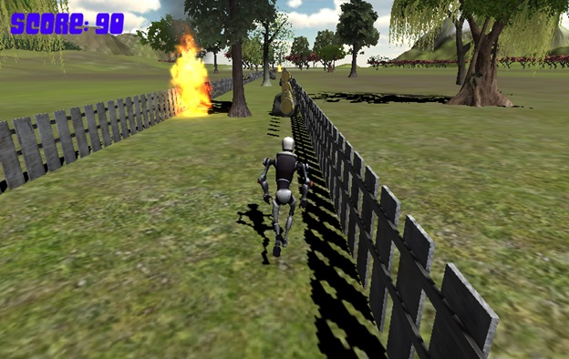

# RobotRun game

  

A documentation record of a Unity3D game controlled with an Intel Creative 3D camera.

Students: Hadar Reuveny, Amit Bekerman.

Supervision: Aaron Wetzler.

## Available materials

The historical project was a Unity3D running game controlled by hand position from a device named in the archived description as an Intel Creative 3D camera. The project description also identifies procedurally generated scenery and obstacles.

This repository preserves that description, the student credits and an archived game screenshot. No Unity project, scripts, game assets, executable, camera integration or build configuration has been recovered for publication here. The screenshot is from the historical game; no playable build is included.

## Use and validation

There is no software to install or run from this repository. The historical Unity and camera SDK versions are not established by the available materials, and no build, hand-control test, gameplay run or performance measurement was performed for this archive. Use the website link below for the original project record.

## Links

- [Project entry on Aaron Wetzler's website](https://twerdster.github.io/#robotrun-game)

## Attribution and reuse

The credits above follow the archived project page. No license for unrecovered source code is implied by this README. Original authors can open an issue to contribute updates or request corrections or removal of their material.

On 2026-11-13, Hadar Reuveny agreed to Aaron Wetzler keeping the archival project page and repository with Hadar's name credited, and to Aaron Wetzler trying to get the old code running with any updates clearly labeled. This records Hadar Reuveny's response only; no software license is added. The reply supplied no files or links. Restoring the code would be future work; no Unity source has been recovered here.

Figure provenance: `assets/project-preview.jpg` is the original student-project game screenshot from the archived project page on Aaron Wetzler's website, copied without modification.
