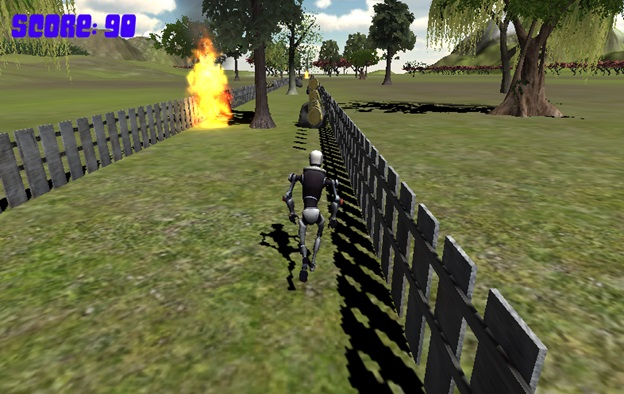

# RobotRun

RobotRun was a Unity running game controlled by hand position from a device the archived description calls an Intel Creative 3D camera. The historical description includes generated scenery, obstacles and a robot runner.

Original project: **Hadar Reuveny and Amit Bekerman**. Supervision: **Aaron Wetzler**.

*Unchanged screenshot from the historical Unity game.*

The original Unity/C# project and camera integration remain missing. The [preserved original README](original/README.md) retains the project record and attribution.

## Updated

**[Open the browser demo](https://twerdster.github.io/robotrun-game/)** · [Updated guide](updated/README.md)

The new TypeScript/Three.js browser game provides three lanes, coins, jumping, ducking and fire that temporarily reverses controls. Keyboard and touch work without a camera; optional MediaPipe input uses locally served models. This is new code, not a port of the missing Unity source. Live hand play and physical phones remain untested.

[Setup and controls (Node.js 22.12+)](updated/browser/README.md) · [Recorded checks and limitations](updated/browser/docs/VALIDATION.md) · [Original README](original/README.md)

## Project record and rights

[Historical context, attribution and recovery details](PROJECT_RECORD.md) preserve the earlier record. Original material, datasets, dependencies and new code keep their separately stated terms; no blanket license is added.
