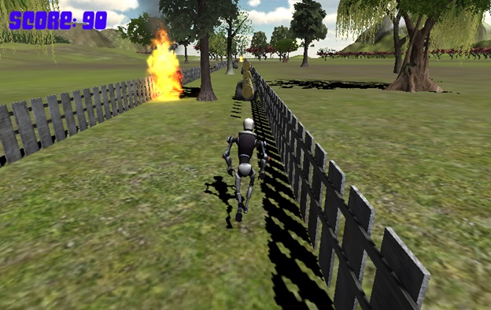

# Original RobotRun project

Students: Hadar Reuveny and Amit Bekerman. Supervision: Aaron Wetzler,
Technion.

This is the original game screenshot recovered from Aaron's Technion project
page, preserved without modification. It is separate from the updated browser
implementation.

## Historical design

RobotRun was developed in Unity3D for an Intel Creative interactive gesture
camera and the Intel Perceptual Computing SDK. Its report describes a robot
running on a procedurally generated three-lane course. Horizontal hand position
chooses a lane, with different entry/exit thresholds to reduce flicker. Raising
the hand jumps. Coins add ten points; rocks and trees can end a run. Fire
temporarily reverses horizontal controls and makes downward hand movement
trigger a jump. A finish line completes the course.

The recovered report names the SDK wrapper files `pxcupipeline.cs`,
`pxcm-structures.cs` and `libpxcupipeline.dll`. Their names are evidence of the
historical dependency, not files included in this repository. The presentation
is dated January 2014; exact Unity/SDK versions and original build behavior
are not established by the recovered materials.

## Recovery status

No Unity project, C# game scripts, original game assets, executable or complete
camera SDK package was recovered. The old archive link did not yield the Unity
source. The report and presentation were inspected privately; copies containing
personal student identifiers are not redistributed here. The historical
screenshot, description and credits remain available.

The new [browser implementation](../updated/browser/) reimplements documented
ideas. It is not compiled from the unrecovered Unity source and does not claim
bitwise, visual or behavioral equivalence to the original game.

## Attribution and author responses

On 2026-11-13, Hadar Reuveny agreed to Aaron keeping the archival page and
repository with Hadar credited, and to trying to get the old code running with
updates clearly labeled. Amit Bekerman agreed to keeping the project page
with Amit credited. Neither response supplied code or adds a standard software
license; the individual responses do not establish rights to third-party assets.

Original authors can contribute corrections or request changes/removal through
the repository. Private messages and personal contact addresses are not included.

[Academic project page](https://twerdster.github.io/#robotrun-game).
