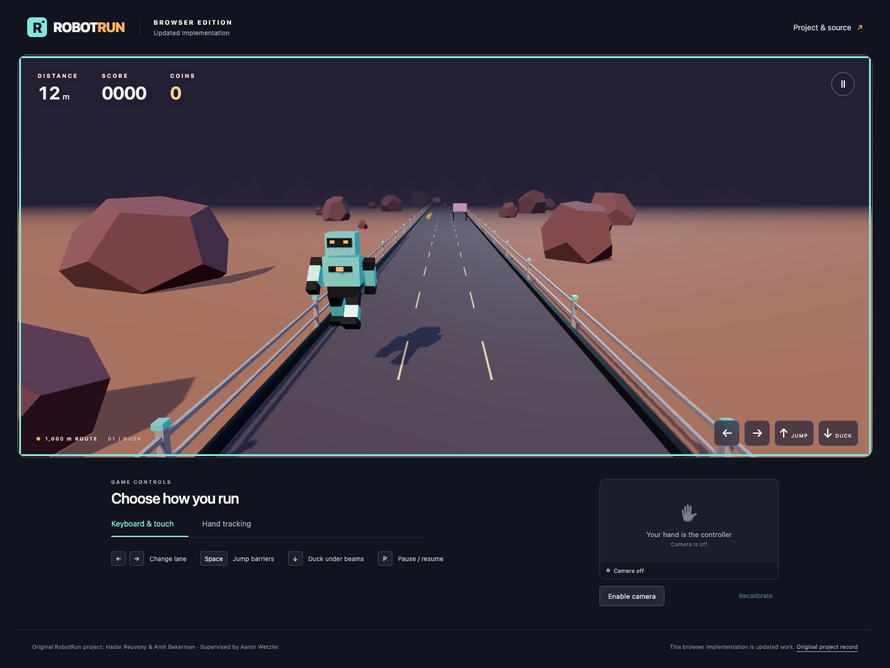

# RobotRun: updated work

## Updated work

**[Open the browser demo](https://twerdster.github.io/robotrun-game/)**

The **new browser game** uses TypeScript, Three.js and optional MediaPipe hand input. Keyboard and touch play work without a camera. It is new code, not a port of the Unity game, whose source has not been recovered.

[Detailed implementation, setup and recorded results](DETAILS.md).

Historical project: Hadar Reuveny and Amit Bekerman; supervision: Aaron Wetzler. New implementations are labeled separately and do not change the preserved materials.

*Separate new browser game; original Unity source remains missing.*
