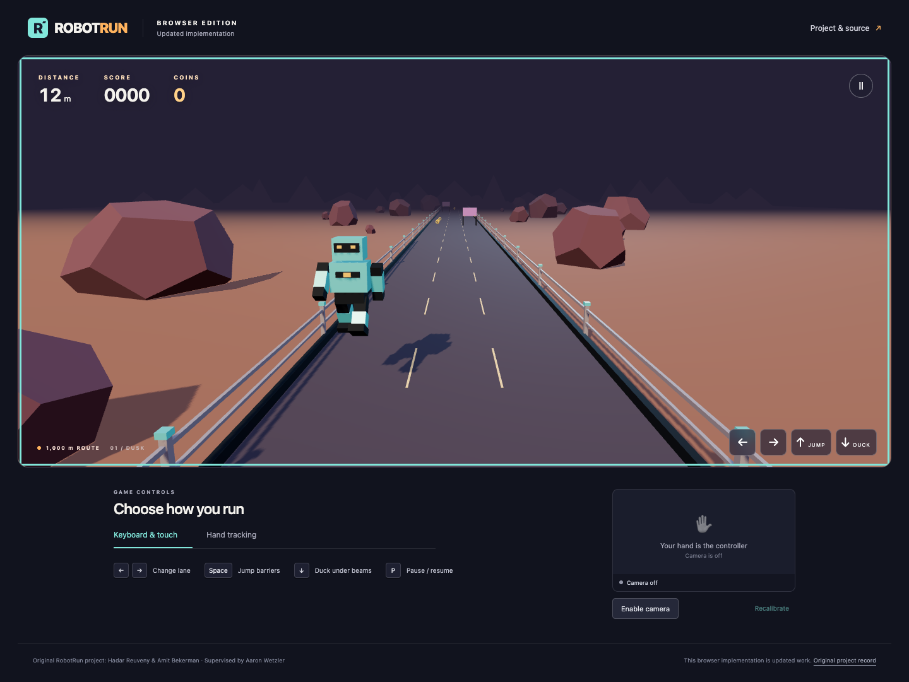

# Updated RobotRun

## Updated and ported for modern hardware

This is a separately written TypeScript/Three.js browser game based on documented RobotRun ideas, with keyboard, touch and optional MediaPipe webcam controls. The historical Unity/C# source and Intel camera integration remain unrecovered; the browser implementation and procedural artwork are new work.

[Play the browser game](https://twerdster.github.io/robotrun-game/) · [Setup and controls](browser/README.md) · [Implementation source](browser/src/) · [Validation and limitations](browser/docs/VALIDATION.md)



*Current browser output, separate from the archived Unity screenshot and original student code.*

## Use and implementation

The browser version provides a three-lane course, coins, jumping, ducking and temporary control reversal after touching fire. Keyboard and touch play require no camera. Webcam mode requests video only and uses locally served model/WebAssembly files; the game does not record or upload camera frames.

For local setup, use Node.js 22.12 or newer and npm from `updated/browser/`:

```sh
npm ci
npm run dev
```

WebGL 2, WebAssembly and JavaScript are required. Webcam access needs HTTPS or localhost and explicit browser permission. The [browser guide](browser/README.md) covers controls, asset preparation, production builds and camera cleanup.

## Recorded checks and limits

The 2026-11-13 record reports 27 Node regressions, 28 Chromium checks across desktop and phone-emulated layouts, and separate real MediaPipe inference on recorded hand imagery. These are recorded results; this navigation update does not rerun them. No physical live-hand session, physical phone, Safari/Firefox coverage or historical Intel-camera equivalence has been established. See the [validation record](browser/docs/VALIDATION.md) for the tested scenarios and qualifications.

The [MIT license](browser/LICENSE) applies to the new game code. [Third-party terms](browser/THIRD_PARTY_NOTICES.md) and the [original project record](../original/README.md) remain separate. Original students: Hadar Reuveny and Amit Bekerman; supervision and current maintenance: Aaron Wetzler.
